# Spor Takip Uygulaması — Teknik Planlama Dokümanı

> Durum: **Planlama aşaması — kod yazılmadan önce onay bekleniyor.**
> Kapsam: Geliştirici test aşaması (store yayını değil). Türkçe-only. Kural tabanlı AI. Local-first offline mimari.
> Stack: Flutter + Riverpod / ASP.NET Core (LTS) + EF Core / PostgreSQL / JWT.

Bu doküman istenen 9 planlama adımını sırasıyla içerir. Onay verdikten sonra "Geliştirme Yol Haritası" bölümündeki Faz 0'dan başlayarak kodlamaya geçilecektir.

---

## 1. Proje Analizi

Ürün, ciddi bir sporcunun antrenman hayatının tamamını tek uygulamada yöneteceği bir **antrenman işletim sistemi** olarak konumlanıyor. Beş temel sütun var:

**a) İçerik havuzu.** Sistem hareketleri (Admin tarafından yönetilen, medyalı) + kullanıcının kendi özel hareketleri. Bunların üstüne kullanıcı sınırsız şablon ve haftalık plan kurar. Bu katman "veri girişi" katmanı — nadiren dokunulur, zengin olmalı.

**b) Focus Mode (Workout).** Uygulamanın kalbi ve en çok dokunulan ekranı. Buradaki tek metrik: **saniyede kaç dokunuşla set kaydediliyor.** Tüm tasarım felsefesi (otomatik doldurma, ✓ ile ilerleme, akıllı öneri) bu ekranın hızını maksimize etmek için var.

**c) İlerleme takibi.** PR, tahmini 1RM, güç grafikleri, vücut ölçüleri, hareket bazlı geçmiş. Kullanıcının "gelişiyor muyum?" sorusuna görsel cevap.

**d) Beslenme.** Makro/kalori/su hedefleri ve takibi. Antrenman verisiyle çapraz içgörü üretir ("Protein hedefine 30 g kaldı").

**e) Kural tabanlı içgörü motoru.** LLM yok. Geçmiş veriden deterministik istatistik → şablon cümle. Hem geçmişe dönük analiz (antrenman sonu özeti) hem ileriye dönük öneri (bir sonraki set ağırlığı) üretir.

**Rekabet konumu.** Hevy'nin loglama akıcılığı + Alpha Progression'ın progresyon zekâsı + RP/Strong'un hacim analizi hedefleniyor; ancak birebir kopya değil. Ayırt edici avantaj: **local-first çalışan, internet olmadan da progresyon önerisi verebilen, sıfır maliyetli kural tabanlı motor.**

**Mimari zorlayan gizli gereksinimler.** Spec'te üç kritik teknik zorluk gömülü:
1. **Local-first + sync** — offline oluşturulan kayıtların çakışmasız birleşmesi (UUID PK, outbox, tombstone, last-write-wins).
2. **Arka planda çalışan dinlenme sayacı** — iOS/Android arka plan kısıtlamalarına uygun (önceden planlanmış local notification).
3. **Focus Mode'un aşırı düşük sürtünmesi** — placeholder, akıllı öneri, undo, superset akışı.

---

## 2. Eksikler ve Riskler

Spec çok kapsamlı; aşağıdakiler mimariyi **şimdi** etkilediği için karara bağlanmalı.

**2.1 Ölçüm tipi eksikliği (KRİTİK — şema kararı).** Mevcut model her seti `kg × tekrar` varsayıyor. Ama barfiks/dips (bodyweight ± ek ağırlık), plank/carry (süre), koşu/kürek (mesafe+süre), sadece-tekrar hareketleri loglanamıyor. Bu, Set tablosunun temel şeklini değiştirir → sonradan eklemek migration cehennemi. **Çözüm #3.1'de.**

**2.2 İleriye dönük progresyon önerisi yok.** Mevcut motor sadece geçmişi özetliyor ("%10 fazla hacim"). Rakip uygulamaların can damarı ise "bugün ne yapmalıyım" önerisi. Kural tabanlı motorun için birebir uygun ama şablon şemasına `progressionRule` alanı gerekir. **Çözüm #3.2'de.**

**2.3 Medya depolama stratejisi tanımsız (RİSK).** Hareketlerin video/resmi ve kullanıcının ilerleme fotoğrafları nerede duracak belirsiz. Base64'ü DB'ye gömmek felaket olur. **Çözüm #3.3'te.**

**2.4 Sync bağımlılık sırası.** Bir `workout_set`, `workout_session` sunucuda yokken gönderilemez (FK ihlali). Outbox kuyruğu sadece zamana göre değil, **varlık bağımlılık sırasına** göre de gönderim yapmalı (önce session, sonra set). **Çözüm #3.4'te.**

**2.5 Admin rol tohumlama (seeding).** Admin-only "Hareket Yönetimi" var ama ilk admin nasıl oluşuyor tanımsız. Çözüm: DB seed ile sabit bir admin hesabı + JWT `Role` claim kontrolü (backend authorization policy).

**2.6 Set türü ≠ ölçüm tipi karışıklığı.** "Superset" hem set türü listesinde hem de akış (birden fazla hareketi gruplama) olarak geçiyor. Bunlar iki ayrı kavram: Superset bir **gruplama** (session_exercise düzeyinde `supersetGroupId`), Drop/Failure/AMRAP ise **set türü** (set düzeyinde `setType`). Modelde ayrıştırıldı.

**2.7 Yüzde bazlı programlama.** 5/3/1, GZCLP gibi popüler programlar sabit kg değil, 1RM'in %'si ile çalışır. Şablonda opsiyonel `loadType` gerekir. **Çözüm #3.5'te (orta öncelik, ama şema kapısı şimdi açılmalı).**

**2.8 Arka plan sayaç sınırı (RİSK — kabul).** iOS'ta gerçek arka plan timer'ı çalıştırılamaz. Çözüm: sayaç başladığında bitiş anına **önceden planlanmış local notification** kurulur; UI foreground'a dönünce kalan süre `endTime - now` ile yeniden hesaplanır. Bu, spec'in de işaret ettiği doğru yaklaşım.

---

## 3. Profesyonel Çözüm Önerileri

Önceki mesajda kritik işaretlenen ikisini (**metric type + progresyon**) plana dahil ettim, çünkü şema kararı gerektiriyorlar ve sonradan eklenmeleri maliyetli.

**3.1 Ölçüm tipi (metric type) — hareket bazında.** `Exercise.metricType` enum'u eklenir: `weightReps` (varsayılan), `bodyweightReps`, `weightedBodyweight` (barfiks +10 kg / assisted −20 kg), `duration` (plank), `distanceDuration` (koşu). `WorkoutSet` tablosuna nullable `durationSeconds` ve `distanceMeters` alanları eklenir. Hacim/PR/1RM hesapları metric type'a göre dallanır (ör. duration hareketinde 1RM yok, "en uzun süre" PR'ı var).

**3.2 Progresyon motoru (rule-based, ileriye dönük).** Focus Mode'da placeholder olarak "son antrenman" yerine **"önerilen sonraki set"** gösterilir. Kural örneği: hedef tekrar aralığının üst sınırını tüm setlerde geçtiysen → +2.5 kg (üst gövde) / +5 kg (alt gövde) öner ve tekrarları alt sınıra çek (double progression). Şablona `progressionRule` (none / doubleProgression / linear / percentageBased) + parametreler eklenir. Tamamen deterministik, offline çalışır.

**3.3 Medya depolama.** Sistem hareket medyası: backend'de statik dosya klasörü (`/media/exercises/...`), API sadece **URL** döner; ileride CDN/object storage'a taşınabilir. İlk sürümde en sık kullanılan sistem hareketlerinin görselleri uygulama asset'i olarak bundle edilebilir (offline görünürlük). Kullanıcı ilerleme fotoğrafları ve özel hareket görselleri: **cihazda yerel** saklanır (yol Hive'da tutulur), backend upload'ı sonraki faza opsiyonel bırakılır. DB'ye asla binary gömülmez.

**3.4 Outbox / sync kuyruğu — bağımlılık sıralı.** Her değişiklik Hive'daki `sync_queue` kutusuna `{entityType, entityId, op, payload, dependsOn, updatedAt, retryCount}` olarak yazılır. Gönderim topolojik sıraya göre: `Exercise → Template → Session → SessionExercise → Set`. Sunucu `POST /sync/push` batch'i idempotent işler (UUID sayesinde upsert). `GET /sync/pull?since=` ile karşı yön çekilir. Çakışma: `updatedAt` last-write-wins. Silme: tombstone (`isDeleted=true`) senkronlanır, iki taraf da temizler.

**3.5 Yüzde bazlı programlama (orta öncelik).** `TemplateExercise.loadType` (absolute / percentageOf1RM) + `percentage`. Absolute varsayılan; şema kapısı şimdi açılır, UI ileride zenginleştirilir.

**3.6 Ek kural tabanlı içgörüler (düşük maliyet, yüksek değer).** Plato tespiti (3 oturum ilerleme yoksa deload öner), kas grubu başına haftalık set hacmi vs. hedef aralık, otomatik ısınma seti üretimi, alternatif hareket önerisi. Motorun içine kural olarak eklenir; şema değişikliği gerektirmez.

**3.7 MediatR önerisi (yeni paket).** CQRS "gereken yerde" isteniyor; MediatR bunun endüstri standardı mediator'ı. Application katmanında Command/Query ayrımını temiz tutar, controller'ları inceltir. Alternatif elle yazılabilir ama MediatR bakım maliyetini ciddi düşürür — **önerim: dahil edilsin.** (Onayına bağlı; istemezsen elle handler pattern uygularım.)

---

## 4. Sistem Mimarisi

### 4.1 Genel Topoloji

```
┌─────────────────────────────┐         ┌──────────────────────────────┐
│      FLUTTER (Mobil)         │         │     ASP.NET Core API (LTS)   │
│                              │  HTTPS  │                              │
│  Presentation (Riverpod)    │◄───────►│  API Layer (Controllers)     │
│        │                     │  JWT +  │        │                     │
│  Application (Providers/UC)  │ Refresh │  Application (CQRS/MediatR)  │
│        │                     │         │        │                     │
│  Domain (Entities/Models)   │         │  Domain (Entities/Rules)     │
│        │                     │  /sync  │        │                     │
│  Data (Repository)          │◄───────►│  Infrastructure (EF Core)    │
│    ├─ Local: Hive (SoT)     │  push/  │        │                     │
│    └─ Remote: Dio           │  pull   │  PostgreSQL                  │
│         │                    │         └──────────────────────────────┘
│    Sync Engine (Outbox)     │
└─────────────────────────────┘
        SoT = Source of Truth (local-first)
```

**Temel ilke:** Flutter tarafında **Hive gerçeğin kaynağıdır (source of truth)**. UI her zaman Hive'dan okur; backend sadece senkronizasyon hedefidir. Bu, offline'da tam işlevsellik ve anlık UI tepkisi (optimistic update) sağlar.

### 4.2 Backend — Clean Architecture Katmanları

**Domain:** Entity'ler, enum'lar, iş kuralları (PR tespiti, 1RM formülü, progresyon kuralları), value object'ler. Hiçbir dış bağımlılık yok.

**Application:** CQRS (MediatR ile Command/Query), DTO'lar, FluentValidation validator'ları, AutoMapper profilleri, servis arayüzleri, kural tabanlı **InsightEngine** ve **ProgressionEngine** (saf hesaplama, test edilebilir).

**Infrastructure:** EF Core DbContext, PostgreSQL provider, migration'lar, Repository implementasyonları, JWT/Refresh token servisi, Serilog, dosya/medya servisi, sync handler'ları.

**API:** Controller'lar, middleware (exception handling, auth), Swagger/OpenAPI, authorization policy'leri (Admin rolü), DI kayıtları.

**Neden:** SOLID + test edilebilirlik + katman bağımsızlığı. InsightEngine ve ProgressionEngine'in Application'da saf fonksiyon olması, xUnit ile deterministik test edilmelerini sağlar.

### 4.3 Flutter — Feature-First + Katmanlı

Her özellik (feature) kendi `presentation / application / domain / data` alt katmanlarını taşır. Riverpod ile state, Dio ile HTTP, Hive ile yerel depolama. Ortak **Design System** ve **Core** paylaşılan modüllerde. Sync Engine bağımsız bir servis olarak tüm feature'ların repository'lerini besler.

---

## 5. Veritabanı ER Diyagramı (PostgreSQL)

Tüm ana tablolar **UUID PK** kullanır. Ortak kolonlar: `id (uuid)`, `created_at`, `updated_at`, `is_deleted (tombstone)`. İstemci tarafındaki Hive kutuları ayrıca `is_synced` taşır (sunucuda gerekmez; sunucu daima senkronize kabul edilir).

```mermaid
erDiagram
    USERS ||--o{ REFRESH_TOKENS : has
    USERS ||--o{ EXERCISES : owns
    USERS ||--o{ WORKOUT_TEMPLATES : creates
    USERS ||--o{ WEEKLY_PLANS : creates
    USERS ||--o{ WORKOUT_SESSIONS : performs
    USERS ||--o{ PERSONAL_RECORDS : holds
    USERS ||--o{ BODY_MEASUREMENTS : records
    USERS ||--o{ NUTRITION_LOGS : logs
    USERS ||--o{ NUTRITION_TARGETS : sets
    USERS ||--o{ PROGRESS_PHOTOS : uploads
    USERS ||--o{ USER_BADGES : earns

    MUSCLE_GROUPS ||--o{ EXERCISES : primary
    MUSCLE_GROUPS ||--o{ EXERCISE_SECONDARY_MUSCLES : secondary
    EQUIPMENT ||--o{ EXERCISES : uses
    EXERCISES ||--o{ EXERCISE_SECONDARY_MUSCLES : has
    EXERCISES ||--o{ TEMPLATE_EXERCISES : referenced
    EXERCISES ||--o{ SESSION_EXERCISES : referenced
    EXERCISES ||--o{ PERSONAL_RECORDS : for

    WORKOUT_TEMPLATES ||--o{ TEMPLATE_EXERCISES : contains
    TEMPLATE_EXERCISES ||--o{ TEMPLATE_SETS : defines
    WEEKLY_PLANS ||--o{ WEEKLY_PLAN_DAYS : contains
    WORKOUT_TEMPLATES ||--o{ WEEKLY_PLAN_DAYS : assigned

    WORKOUT_SESSIONS ||--o{ SESSION_EXERCISES : contains
    SESSION_EXERCISES ||--o{ WORKOUT_SETS : contains
    WORKOUT_SETS ||--o{ PERSONAL_RECORDS : triggers

    BADGES ||--o{ USER_BADGES : awarded

    USERS {
        uuid id PK
        string email UK
        string password_hash
        string display_name
        string role "User|Admin"
        timestamp created_at
        timestamp updated_at
        bool is_deleted
    }
    REFRESH_TOKENS {
        uuid id PK
        uuid user_id FK
        string token_hash
        timestamp expires_at
        bool revoked
    }
    MUSCLE_GROUPS {
        uuid id PK
        string name
        string body_region "upper|lower|core"
    }
    EQUIPMENT {
        uuid id PK
        string name
    }
    EXERCISES {
        uuid id PK
        string name
        uuid primary_muscle_group_id FK
        uuid equipment_id FK
        string metric_type "weightReps|bodyweightReps|weightedBodyweight|duration|distanceDuration"
        string video_url
        string image_url
        string description
        bool is_custom
        uuid owner_user_id FK "null=system"
        timestamp updated_at
        bool is_deleted
    }
    EXERCISE_SECONDARY_MUSCLES {
        uuid exercise_id FK
        uuid muscle_group_id FK
    }
    WORKOUT_TEMPLATES {
        uuid id PK
        uuid user_id FK
        string name
        string notes
        timestamp updated_at
        bool is_deleted
    }
    TEMPLATE_EXERCISES {
        uuid id PK
        uuid template_id FK
        uuid exercise_id FK
        int order_index
        int target_sets
        string load_type "absolute|percentageOf1RM"
        decimal target_weight
        decimal percentage
        int target_reps
        int rest_seconds
        string note
        uuid superset_group_id "null=solo"
        string progression_rule "none|doubleProgression|linear|percentageBased"
    }
    TEMPLATE_SETS {
        uuid id PK
        uuid template_exercise_id FK
        int set_number
        string set_type
        decimal target_weight
        int target_reps
        int rest_seconds
    }
    WEEKLY_PLANS {
        uuid id PK
        uuid user_id FK
        string name
        bool is_active
    }
    WEEKLY_PLAN_DAYS {
        uuid id PK
        uuid weekly_plan_id FK
        int day_of_week "1-7"
        uuid template_id FK "null=rest day"
    }
    WORKOUT_SESSIONS {
        uuid id PK
        uuid user_id FK
        uuid template_id FK "null=manual"
        string name
        string status "inProgress|completed|aborted"
        timestamp started_at
        timestamp ended_at
        decimal total_volume
        int total_sets
        int total_reps
        int estimated_calories
        string note
        timestamp updated_at
        bool is_deleted
    }
    SESSION_EXERCISES {
        uuid id PK
        uuid session_id FK
        uuid exercise_id FK
        int order_index
        uuid superset_group_id
        string note
    }
    WORKOUT_SETS {
        uuid id PK
        uuid session_exercise_id FK
        int set_number
        string set_type "Normal|WarmUp|DropSet|Failure|AMRAP|RestPause|Cluster|Tempo"
        decimal weight
        int reps
        int duration_seconds
        decimal distance_meters
        int rpe "1-10 nullable"
        string note
        bool is_completed
        bool is_pr
        timestamp completed_at
        timestamp updated_at
        bool is_deleted
    }
    PERSONAL_RECORDS {
        uuid id PK
        uuid user_id FK
        uuid exercise_id FK
        string record_type "estimated1RM|maxWeight|maxReps|maxVolume|maxDuration"
        decimal value
        decimal weight
        int reps
        uuid source_set_id FK
        timestamp achieved_at
    }
    BODY_MEASUREMENTS {
        uuid id PK
        uuid user_id FK
        timestamp measured_at
        decimal bodyweight
        jsonb measurements "chest,waist,arm,thigh..."
        timestamp updated_at
        bool is_deleted
    }
    NUTRITION_LOGS {
        uuid id PK
        uuid user_id FK
        date log_date
        int calories
        int protein_g
        int carbs_g
        int fat_g
        int water_ml
        timestamp updated_at
        bool is_deleted
    }
    NUTRITION_TARGETS {
        uuid id PK
        uuid user_id FK
        int calories
        int protein_g
        int carbs_g
        int fat_g
        int water_ml
        timestamp effective_from
    }
    PROGRESS_PHOTOS {
        uuid id PK
        uuid user_id FK
        timestamp taken_at
        string file_path
        string note
        bool is_deleted
    }
    BADGES {
        uuid id PK
        string code UK
        string name
        string description
    }
    USER_BADGES {
        uuid id PK
        uuid user_id FK
        uuid badge_id FK
        timestamp earned_at
    }
```



**Index stratejisi:** `exercises(primary_muscle_group_id)`, `exercises(owner_user_id)`, `workout_sessions(user_id, started_at DESC)`, `session_exercises(session_id)`, `workout_sets(session_exercise_id)`, `personal_records(user_id, exercise_id)`, `nutrition_logs(user_id, log_date)`, ve tüm tablolarda `updated_at` (sync pull için). Streak takvimi ayrı tablo değil, `workout_sessions.started_at` üzerinden tarih bazında türetilir (gereksiz denormalizasyondan kaçınıldı).

---

## 6. Klasör Yapısı

### 6.1 Backend (ASP.NET Core — Clean Architecture)

```
FitApp.Backend/
├── src/
│   ├── FitApp.Domain/
│   │   ├── Entities/            (User, Exercise, WorkoutSession, WorkoutSet, ...)
│   │   ├── Enums/               (MetricType, SetType, ProgressionRule, RecordType)
│   │   ├── ValueObjects/
│   │   └── Common/              (BaseEntity: Id, CreatedAt, UpdatedAt, IsDeleted)
│   │
│   ├── FitApp.Application/
│   │   ├── Common/
│   │   │   ├── Interfaces/      (IRepository, IAppDbContext, IJwtService, IMediaService)
│   │   │   ├── Behaviors/       (ValidationBehavior, LoggingBehavior — MediatR pipeline)
│   │   │   └── Mappings/        (AutoMapper Profiles)
│   │   ├── Features/
│   │   │   ├── Auth/            (Commands: Register, Login, Refresh)
│   │   │   ├── Exercises/       (Queries + Admin Commands)
│   │   │   ├── Templates/
│   │   │   ├── WeeklyPlans/
│   │   │   ├── Sessions/
│   │   │   ├── Sets/
│   │   │   ├── PersonalRecords/
│   │   │   ├── BodyMeasurements/
│   │   │   ├── Nutrition/
│   │   │   ├── Sync/            (PushChanges, PullChanges)
│   │   │   └── Insights/
│   │   ├── Engines/
│   │   │   ├── InsightEngine/   (kural tabanlı analiz — saf, test edilebilir)
│   │   │   └── ProgressionEngine/
│   │   └── DependencyInjection.cs
│   │
│   ├── FitApp.Infrastructure/
│   │   ├── Persistence/
│   │   │   ├── AppDbContext.cs
│   │   │   ├── Configurations/  (EF Fluent API + index'ler)
│   │   │   ├── Migrations/
│   │   │   └── Seed/            (Admin user, muscle groups, equipment, sistem hareketleri)
│   │   ├── Repositories/
│   │   ├── Auth/               (JwtService, RefreshTokenService)
│   │   ├── Media/              (dosya sistemi medya servisi)
│   │   ├── Logging/            (Serilog config)
│   │   └── DependencyInjection.cs
│   │
│   └── FitApp.Api/
│       ├── Controllers/
│       ├── Middleware/         (ExceptionHandling, RequestLogging)
│       ├── Authorization/      (AdminPolicy)
│       ├── Program.cs
│       └── appsettings.json
│
└── tests/
    ├── FitApp.Domain.Tests/
    ├── FitApp.Application.Tests/   (InsightEngine + ProgressionEngine testleri kritik)
    └── FitApp.Api.IntegrationTests/
```

### 6.2 Flutter (Feature-First + Katmanlı)

```
lib/
├── main.dart
├── app/                         (MaterialApp, router, tema başlatma)
├── core/
│   ├── config/                  (env, constants)
│   ├── network/                 (Dio client, interceptor: JWT + refresh)
│   ├── storage/                 (Hive init, box'lar, secure storage)
│   ├── sync/                    (SyncEngine, Outbox, ConflictResolver)
│   ├── notifications/           (flutter_local_notifications — rest timer)
│   ├── error/                   (Failure, exception mapping)
│   └── utils/                   (formatters, extensions)
│
├── design_system/               (TEK KAYNAK — her ekran buraya bağlanır)
│   ├── theme/                   (colors, typography, spacing[8px], radius)
│   ├── components/              (AppButton, AppCard, AppBottomSheet, AppDialog,
│   │                             SetRow, ExerciseCard, StatTile)
│   ├── animations/              (page transitions, shimmer, skeleton, confetti)
│   └── icons/
│
├── features/
│   ├── auth/            {presentation, application, domain, data}
│   ├── dashboard/       {presentation, application, domain, data}
│   ├── workout/         (Focus Mode + rest timer + smart resume + superset)
│   ├── programs/        (templates + weekly plan)
│   ├── exercises/       (havuz + detay/geçmiş + admin yönetimi)
│   ├── progress/        (PR, 1RM, grafikler, vücut ölçüleri, foto)
│   ├── nutrition/       (makro, kalori, su)
│   ├── insights/        (kural tabanlı içgörüler)
│   ├── gamification/    (streak takvimi, rozet, kutlama)
│   ├── profile/
│   └── export/          (Excel, CSV, PDF, JSON)
│
└── shared/                      (feature-agnostik model/widget)
```

**Neden bu yapı:** Design System ayrı ve merkezî bir modül olarak duruyor — "her ekran kendi bileşenini üretmesin" kuralının teknik garantisi. Feature'lar birbirini import etmez; ortak ihtiyaç `core`/`shared`/`design_system`'e taşınır.

---

## 7. Sayfa Akışları

### 7.1 Uygulama Açılış / Auth

```
Splash → (secure storage'da geçerli token var mı?)
   ├─ Evet → Dashboard (arka planda sync pull tetiklenir)
   └─ Hayır → Login ⇄ Register
                 └─ başarı → token secure storage'a → Dashboard
```

### 7.2 Ana Navigasyon (4 sekme)

```
BottomNav: [ Dashboard | Workout | Programs | Profile ]
```

### 7.3 Focus Mode (Workout) — Kritik Akış

```
Dashboard "Antrenmana Başla" / Programs "Başlat" / Manuel Başlat
        │
        ▼
[Smart Resume kontrolü]  ── yarım oturum var mı? ──► "Devam et" banner'ı (tek dokunuş)
        │ yoksa
        ▼
Yeni WorkoutSession (status=inProgress, Hive'a yazılır → outbox)
        │
        ▼
┌──────────────────────────────────────────────┐
│  Focus Mode ekranı                            │
│  • Her hareket = ExerciseCard                 │
│    (ad, kas grubu, hedef set, dinlenme,       │
│     "son antrenman" / "önerilen set")         │
│  • Her set satırı: [Kg] [Tekrar] [✓]         │
│    - placeholder = progresyon önerisi         │
│  • ✓ tek set → dinamik dinlenme sayacı başlar │
│    (set türüne göre süre; kilit ekranı bildirim)│
│  • "Tümünü Onayla" → sayaç başlamaz           │
│  • ✓ geri al (undo)                           │
│  • "Hareket Ekle" (plansız serbest ekleme)    │
│  • RPE + not (opsiyonel, per set)             │
│  • Superset grubu → hareketler arası otomatik │
│    geçiş, dinlenme superset bitince başlar     │
└──────────────────────────────────────────────┘
        │  "Antrenmanı Bitir"
        ▼
Antrenman Sonu Özeti (süre, set, tekrar, hacim, kalori, kaslar, PR)
   + kural tabanlı analiz cümleleri
   + PR/tamamlanma → kutlama anı (konfeti + ses/titreşim)
        │
        ▼
session.status=completed → Hive → outbox → Dashboard
```

### 7.4 Programlar

```
Programs
 ├─ Şablonlar listesi → Şablon Editörü
 │     └─ Hareket ekle → Havuzdan seç → set/tekrar/ağırlık/dinlenme/not/superset/progresyon
 └─ Haftalık Plan → Pzt–Paz gün kartları → her güne şablon ata (veya dinlenme)
```

### 7.5 Hareket Havuzu ve Detay

```
Hareketler → [arama + kas grubu/ekipman filtresi]
   ├─ Hareket Detay/Geçmiş
   │     ├─ Geçmiş kayıtlar (tarih + kg×tekrar)
   │     ├─ Ağırlık/hacim değişim grafiği (fl_chart)
   │     └─ PR tarihçesi
   ├─ "Kendi hareketimi ekle" (is_custom)
   └─ [Admin ise] Hareket Yönetimi (sistem hareketi ekle/düzenle/sil)
```

### 7.6 Profil / İlerleme

```
Profile → Makrolar · Kalori · Su · Vücut ölçüleri · Güç analizi (1RM) ·
          Grafikler · PR listesi · Rozetler · Kas ısı haritası ·
          İlerleme fotoğrafları · Insights · Dışa Aktar
```

---

## 8. API Mimarisi (REST + Sync)

JWT Bearer auth; `Admin` uçları policy ile korunur. Tüm koleksiyon uçları sayfalama destekler. Tarih/versiyon senkronu `updated_at` üzerinden.

**Auth**
```
POST   /api/auth/register
POST   /api/auth/login              → { accessToken, refreshToken }
POST   /api/auth/refresh
POST   /api/auth/logout
```

**Katalog (hareket havuzu / meta)**
```
GET    /api/exercises?muscleGroup=&equipment=&search=&page=
GET    /api/exercises/{id}
GET    /api/exercises/{id}/history           (kullanıcının o harekete ait geçmişi + PR)
POST   /api/exercises                          (kullanıcı özel hareketi)
PUT    /api/exercises/{id}                      (sahibi ya da Admin)
DELETE /api/exercises/{id}
GET    /api/muscle-groups
GET    /api/equipment
--- Admin only ---
POST   /api/admin/exercises                    [AdminPolicy]  (sistem hareketi)
PUT    /api/admin/exercises/{id}               [AdminPolicy]
DELETE /api/admin/exercises/{id}               [AdminPolicy]
POST   /api/admin/exercises/{id}/media         [AdminPolicy]  (resim/video upload)
```

**Programlar**
```
GET/POST/PUT/DELETE  /api/templates
GET/POST/PUT/DELETE  /api/weekly-plans
PUT                  /api/weekly-plans/{id}/days   (gün→şablon atama)
```

**Antrenman**
```
GET    /api/sessions?from=&to=
GET    /api/sessions/{id}
GET    /api/sessions/active                     (Smart Resume için)
POST   /api/sessions
PUT    /api/sessions/{id}                         (bitir/güncelle)
DELETE /api/sessions/{id}
POST   /api/sessions/{id}/exercises               (plansız hareket ekle)
POST   /api/sessions/{sid}/sets
PUT    /api/sets/{id}                              (kg/tekrar/RPE/not/✓/undo)
DELETE /api/sets/{id}
```

**İlerleme & Beslenme**
```
GET/POST             /api/personal-records
GET/POST/PUT         /api/body-measurements
GET/POST/PUT         /api/nutrition/logs?date=
GET/PUT              /api/nutrition/targets
GET/POST/DELETE      /api/progress-photos
```

**İçgörü Motoru**
```
GET    /api/insights/summary                     (dashboard/profil içgörüleri)
GET    /api/insights/session/{id}                (antrenman sonu analizi)
GET    /api/progression/suggestion?exerciseId=   (önerilen sonraki set)
```

**Senkronizasyon (local-first çekirdek)**
```
POST   /api/sync/push     { changes: [{entityType, entityId, op, payload, updatedAt}] }
                          → idempotent upsert (UUID), tombstone işleme, LWW çakışma
GET    /api/sync/pull?since={timestamp}
                          → { changes: [...], serverTime }
```

**Dışa Aktarma**
```
GET    /api/export?format=csv|xlsx|pdf|json&scope=all|sessions|nutrition
```

**Not:** Export'un büyük kısmı istemci tarafında da üretilebilir (offline). Backend ucu sunucu-tarafı tam yedek içindir. Çevrimdışı senaryoda öncelik istemci export'u.

---

## 9. Geliştirme Yol Haritası

Backend ve Flutter büyük ölçüde paralel ilerler; her faz sonunda çalışan bir dikey dilim (vertical slice) hedeflenir. xUnit testleri (özellikle Engine'ler) her fazın parçasıdır.

**Faz 0 — Temel (İskele).** Git/GitHub repo, çözüm iskeleti (4 katman), Flutter proje + klasör yapısı, PostgreSQL + EF Core ilk migration, Serilog, Swagger, **Design System temeli** (tema, renk, tipografi, 8px spacing, temel bileşenler), Dark/Light mode. Çıktı: boş ama derlenen iki uygulama + tema.

**Faz 1 — Auth + Katalog + Admin.** JWT + refresh token, secure storage, muscle group/equipment/sistem hareketi seed, hareket havuzu (arama + filtre), kullanıcı özel hareketi, Admin "Hareket Yönetimi" ekranı ve korumalı uçlar. Çıktı: giriş yapılıp hareket havuzunda gezilebilir.

**Faz 2 — Programlar.** Şablon editörü (hareket/set/tekrar/ağırlık/dinlenme/not/superset/progresyon alanları), haftalık plan atama. Çıktı: kullanıcı kendi programını kurabilir.

**Faz 3 — Focus Mode (KALP).** Antrenman oturumu, ExerciseCard, set satırı ✓/undo, "son antrenman" placeholder, Tümünü Onayla, **dinamik dinlenme sayacı** (arka plan + kilit ekranı bildirimi + ses/titreşim), plansız Hareket Ekle, RPE+not, superset akışı, **Smart Resume**. Çıktı: gerçek salonda kullanılabilir loglama.

**Faz 4 — Offline Sync Motoru.** Hive'ı source-of-truth yap, Outbox + bağımlılık sıralı gönderim, `sync/push` + `sync/pull`, tombstone, last-write-wins, retry + "senkronize edilemedi" bildirimi. Çıktı: uçak modunda tam çalışır, bağlanınca birleşir.

**Faz 5 — İlerleme Takibi.** Antrenman sonu özeti + hesaplamalar, PR tespiti, tahmini 1RM, güç/hacim grafikleri (fl_chart), hareket detay/geçmiş ekranı, vücut ölçüleri, ilerleme fotoğrafları. Çıktı: gelişim görünür.

**Faz 6 — Beslenme.** Makro/kalori/su hedef ve takibi, dashboard entegrasyonu. Çıktı: protein hedefi içgörüsü çalışır.

**Faz 7 — Kural Tabanlı Motorlar.** InsightEngine (30 günde en çok gelişen hareket, en güçlü kas grubu, ihmal edilen kas, ortalama dinlenme, haftalık hacim değişimi, PR'a kalan), ProgressionEngine (önerilen sonraki set, plato/deload tespiti, otomatik ısınma). Antrenman sonu ve dashboard'a bağlanır. Çıktı: uygulama "akıllı" hisseder.

**Faz 8 — Gamification.** GitHub-tarzı streak takvimi, kutlama anı (konfeti + ses/titreşim), rozet sistemi, kas ısı haritası. Çıktı: duygusal bağ + motivasyon.

**Faz 9 — Dışa Aktarma.** Excel/CSV/PDF/JSON (istemci öncelikli), gelecekteki Drive/iCloud/Health entegrasyonlarına uygun servis arayüzü. Çıktı: veri taşınabilir.

**Faz 10 — Cila.** Hero/implicit animasyonlar, shimmer/skeleton loading, page transition'lar, performans (büyük havuz sanal liste), erişilebilirlik, son UX geçişi. Çıktı: premium his.

---

## Onay İçin Özet

Kritik iki mimari kararı plana **dahil ettim**: (1) hareket bazında ölçüm tipi, (2) ileriye dönük progresyon motoru. Ayrıca medya depolama, bağımlılık sıralı sync ve MediatR önerisini netleştirdim.

**Senden onay beklediğim üç nokta:**
1. Metric type + progresyon motoru dahil kalsın mı? (öneri: evet)
2. MediatR (CQRS için) eklensin mi, yoksa elle handler pattern mi? (öneri: MediatR)
3. Yol haritası fazı sırası uygun mu, yoksa öncelik değişecek mi?

Onay verirsen **Faz 0**'dan (repo iskeleti + Design System + ilk migration) başlıyorum.
